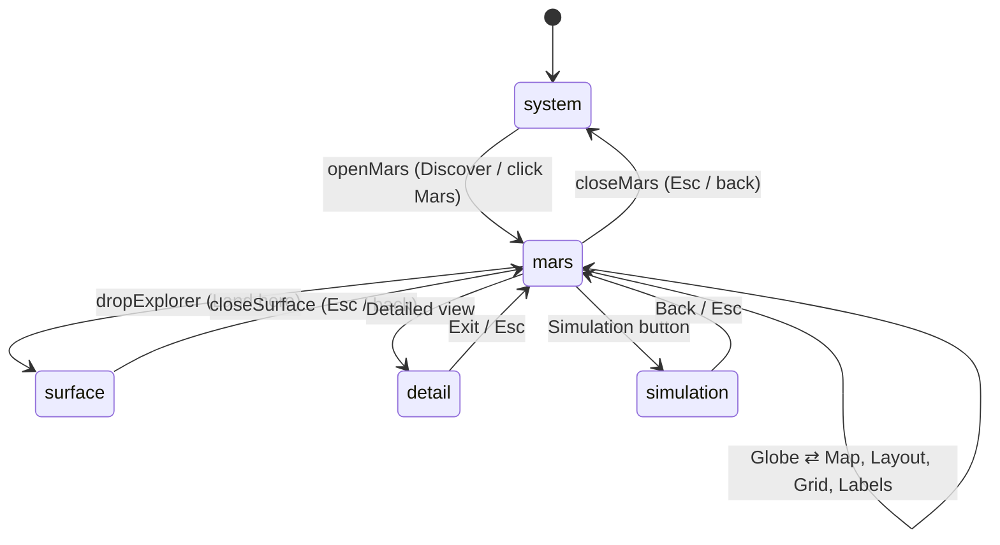
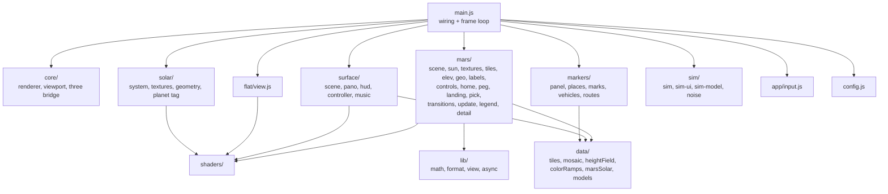
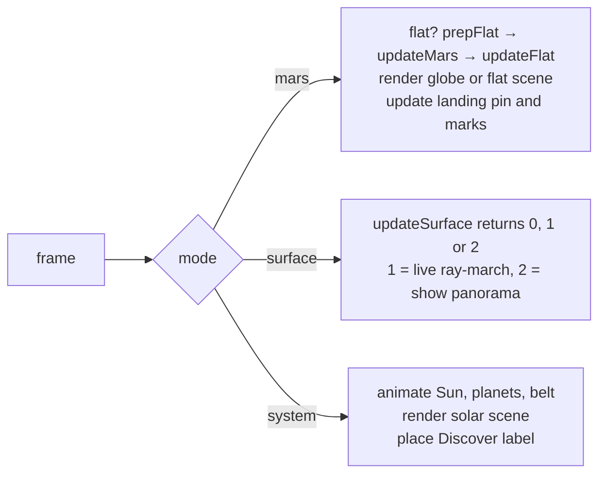

# Architecture

This document explains how **Interplanetary Survival Guide: Martian Map** (`mars-explorer`) is built: its modes, modules, data pipeline, shaders and conventions. It is for developers who want to understand, fix or extend the project.

## Table of Contents

1. [Overview](#overview)
2. [Tech Stack](#tech-stack)
3. [Modes and Navigation](#modes-and-navigation)
4. [Module Map](#module-map)
5. [Wiring and Shared State](#wiring-and-shared-state)
6. [The Frame Loop](#the-frame-loop)
7. [Solar System View](#solar-system-view)
8. [Mars Globe](#mars-globe)
9. [Flat Map](#flat-map)
10. [Data and Tiles](#data-and-tiles)
11. [Shaders](#shaders)
12. [Markers Panel](#markers-panel)
13. [Surface View](#surface-view)
14. [Detailed View](#detailed-view)
15. [Simulations](#simulations)
16. [Sun and Time Model](#sun-and-time-model)
17. [Coordinates and Conventions](#coordinates-and-conventions)
18. [Persistence](#persistence)
19. [User Interface Layer](#user-interface-layer)
20. [Performance](#performance)
21. [Extending the Project](#extending-the-project)

---

## Overview

A single-page WebGL application with these views:

| Mode | What the user sees |
|------|--------------------|
| `system` | Animated Solar System (Sun, 8 planets, asteroid belt, stars) with a "Discover" label above Mars |
| `mars` | Detailed globe with real relief, eight data layers, grid, labels, moons, markers and routes |
| `mars` + flat | The same Mars as a flat equirectangular map (**Globe / Map** switch) |
| `mars` + detail | A high-resolution 3D patch (Gale Crater) laid over the globe and flown close up |
| `surface` | First-person view from a chosen point, with terrain, Mars sky, Sun, stars and music |
| Simulation | A separate 2D-canvas scene: day and night, Phobos and Deimos, marsquake, dust storm |

## Tech Stack

| Area | Technology |
|------|-----------|
| 3D engine | three.js **0.128.0**  |
| Build tool | Vite 5 |
| Language | JavaScript ES modules |
| Shaders | GLSL |
| UI | Plain HTML  plus CSS |
| Simulations | Canvas 2D |
| Tests | Node's built-in test runner |
| Data | Two local height PNGs, one embedded Gale model, moon textures, one music file, and NASA Mars Trek tiles |

## Modes and Navigation



The current mode is `state.mode` in `main.js` (`'system'`, `'mars'`, `'surface'`). Detail and simulation are overlays on top of the `mars` mode: they have their own `active` flags, and the simulation has its own scene container. A second flag, `state.transitioning`, blocks input while a transition runs.

All transitions go through the full-screen **veil** (`#veil`): fade to the loading screen with a "Did you know?" fact, build or switch content, then fade out. `openMars`, `closeMars`, `dropExplorer`, `closeSurface` and the detail enter/exit follow the same pattern, with short `wait()` calls so the CSS fade can finish.

## Module Map



| Folder | Responsibility |
|--------|----------------|
| `core/` | `createRenderer` (WebGL renderer, scene, camera, WebGL-failure fallback), `createViewportController` (resize, camera fit) |
| `solar/` | Solar System scene, procedural planet textures and rocks, the "Discover" label |
| `mars/` | The detailed globe (scene, LOD, layers, controls, picking, labels, home, Explorer pin, landing preview, detailed view) |
| `flat/` | Flat map built on the globe's material |
| `surface/` | First-person renderer, panorama builder, HUD, mode controller, music |
| `markers/` | The left **Markers** panel: places, user marks, vehicles, routes  |
| `sim/` | Simulations |
| `data/` | Tile sources, mosaics, height decoding, color ramps, Mars Sun model, embedded models, loading facts |
| `lib/` | Pure helpers: noise, angles, formatting, view clamps, `wait`/`waitFor` |
| `shaders/` | GLSL sources and `index.js` that concatenates them |
| `app/` | Device detection and all DOM pointer, wheel and keyboard input for the globe and surface |

## Wiring and Shared State

`main.js` creates every module once and connects them. It holds almost no logic of its own.

- **Dependency injection with getters.** Modules receive functions such as `getMarsMat: () => marsMat` instead of objects. This is needed because the Mars scene is built lazily (on first open) and because modules depend on each other in cycles (`peg`, `home`, `marks`, `landing`, `surfaceController`). Getters let `main.js` create them in any order. Home "armed" mode, which the older `home.js` handled, is now served by `marks` (`setHomeArmed` and `getHomeArmed` map to `marks.setArmed` and `marks.getArmed`).
- **`state`** holds `mode`, `transitioning`, `renderDirty` and `uiTimer`.
- **`mv`** is the globe camera state shared by input, controls, transitions and the per-frame update:

| Field | Meaning |
|-------|---------|
| `spin`, `pitch`, `dist` | Current globe rotation and camera distance |
| `tSpin`, `tPitch`, `tDist` | Targets the values are smoothed toward |
| `fit` | Distance at which the whole planet fits the screen |
| `fly`, `auto`, `dragging`, `userZoomed` | Animated fly-to, idle auto-rotation, active drag, manual zoom |
| `vSpin`, `vPitch` | Release velocity for drag inertia |

- **`ui`** is a bundle of `document.getElementById` references (a few dozen elements).
- **`markDirty()`** sets `state.renderDirty`. The globe renders every frame; the surface view uses the flag to avoid redrawing an unchanged image.

## The Frame Loop

`frame()` in `main.js` runs on `requestAnimationFrame`, clamps `dt` to 50 ms, and branches on the mode:



`updateMars(dt, ctx)` (`mars/update.js`) does the globe's per-frame work:

1. smooth distance, run the fly-to animation, drag inertia and idle rotation;
2. apply `spin` to the planet and `pitch` to its parent, and place the camera at `(0, 0, dist)`;
3. call `detail.applyCamera()` when the detailed view is active;
4. update the real Sun direction, the thermally lagged Sun direction and the solar flux for Mars's current orbital distance;
5. move the moons and the Sun light;
6. request texture levels and pick the mesh level of detail (`detail.postUpdate()` follows);
7. update labels;
8. every 0.5 s, refresh the text readout and, unless the detailed view is active, the detail tiles;
9. adapt the pixel ratio if frames are slow.

The simulation has its own `requestAnimationFrame` loop that runs only while it is open (`sim.start()` and `sim.stop()`).

## Solar System View

`solar/system.js` builds the lights, Sun, planets, orbit lines, asteroid belt and star field.

- **Sun:** a sphere with a procedural fragment shader (domain-warped simplex noise) and two additive glow sprites.
- **Planets:** eight spheres with canvas-generated procedural textures (`solar/textures.js`), glow halos, Saturn's rings and Earth's clouds. Sizes and distances are stylized, and speeds are invented rather than taken from ephemerides.
- **Asteroid belt:** 3 variants × 220 instanced rocks between the orbits of Mars and Jupiter, animated on the CPU (`updateBelts`). Rock shapes come from `solar/geometry.js`.
- **Stars:** 1,900 twinkling points on a distant sphere (custom shader).
- **Discover label:** `solar/planet-tag.js` projects Mars to screen space each frame, positions the HTML label above it and fades it out when Mars is behind the Sun.

## Mars Globe

The globe lives in its own scene, built by `mars/scene.js` on first use.

**Scene graph**

```
marsScene
├── marsRoot            ← rotation.x = pitch
│   ├── marsSpin        ← rotation.y = spin
│   │   ├── Mars sphere mesh (one of the LOD meshes, shared marsMat)
│   │   └── (detailed-view patch while active)
│   ├── atmosphere shell (radius 1.1, back-side, additive)
│   └── moon pivots → Phobos, Deimos
├── ambient light + directional light (along the real Sun direction)
└── star Points
```

**Moons.** Phobos and Deimos are low-poly meshes from `detailedMoonGeometry` (`solar/geometry.js`): a potato shape made from broad bumps, Phobos's big crater Stickney, vertex-color shading and equirectangular UVs. Their axis proportions follow the real bodies, but they are enlarged so they stay visible. `assets/moons-*.jpg` are overlaid faintly. Moon name labels are HTML elements (`mars/labels.js`).

**Three independent level-of-detail systems**

| System | File | Levels | Chosen by |
|--------|------|--------|-----------|
| Mesh | `mars/geo.js` | spheres with 160×80, 480×240, 1024×512 segments (the largest is disabled by `MAX_GEO = 1`) | camera distance, with hysteresis |
| Global textures | `mars/textures.js` | 1024×512, 2048×1024, 4096×2048 (touch devices stop one level lower) | camera distance (>4.3, >2.9, closer) |
| Detail window | `mars/tiles.js` | 1024×1024 px window (+64 px padding) of a deeper tile level, centered on the view | zoom 4–7 by distance; active only below about 2.9 radii |

Detail windows are cached (5 on desktop, 2 on touch devices) and their GPU textures are disposed when evicted. A window is replaced when the view centre moves more than 300 px from its centre, and window origins snap to multiples of 256 px.

**Display modes** (Layout menu, `controls.setViewMode`):

| `data-mode` | Layer | Shader `uMode` |
|-------------|-------|----------------|
| 0 | Natural color | 0 |
| 1 | Elevation (MOLA) | 1 |
| 2 | Temperature (modelled, live) | 2 |
| 3–7 | Roughness, Dust, Plagioclase, Glass/Clay, Thermal inertia (Mars Trek overlays) | 3 |

`mars/elev.js` builds the overlay and elevation mosaics, keeps the sphere black with a "Loading…" label until a layer arrives, and falls back to the normal view if tiles fail. `mars/legend.js` draws the legend from the same ramps the shader uses.

**Interaction features**

- `mars/pick.js` converts a screen point to longitude/latitude by intersecting a ray with the unit sphere (or the flat map), and reads elevation from the height PNG.
- `mars/controls.js` owns fly-to, saving and restoring the view (`saveView` / `restoreView` for Places, `saveLandView` / `restoreLandView` for returning from the surface), zoom with hold-to-zoom, grid, the sector caption, the status readout and the detail-tile logic.
- `mars/labels.js` positions HTML labels over the 3D scene: grid labels (fade as they turn away), moon labels (hidden behind the planet), and optional place-name labels that also work on the flat map.
- `mars/home.js` holds the **home point** (a single longitude/latitude), its physics and the highlight uniform. Setting and clearing Home is done from a mark's card (`markers/marks.js`).
- `mars/peg.js` and `mars/landing.js` implement the **Explorer**: drag or click to drop a pin, a small rendered preview of the site (the surface shader drawn into an off-screen target and copied to a canvas), and the **Land here** and **Detailed view** buttons.

## Flat Map

`flat/view.js` reuses the globe's fragment shader (`MARS_FRAG` with `FLAT` defined) and the same uniforms, so textures, layers, grid, place highlight and route all work in both views.

- Geometry: a 4×2 plane repeated three times side by side so longitude wraps seamlessly. `x = lon / 90`, `y = lat / 90`.
- The camera moves over the plane; its zoom comes from the same `mv.dist`.
- Latitude panning is clamped so the view cannot go past the poles. Pan, fly-to and picking have flat versions of the globe logic.
- With `FLAT` defined the shader lights the map evenly, with no night side and no terrain shadows.
- Place-name labels have their own container so they stay visible when the main label layer hides in map mode.

## Data and Tiles

**Tile pyramid** (`data/tiles.js`). WMTS-like equirectangular scheme: at zoom `z` there are `2^(z+1)` columns and `2^z` rows of 256 px tiles; row 0 is the north, column 0 is at −180°. URLs are built from templates with `{z}`, `{row}`, `{col}`, `{Style}` and `{TileMatrixSet}`.

| Layer | Source | Max zoom |
|-------|--------|----------|
| Color | Mars Trek, Viking MDIM 2.1 color mosaic (232 m/px) | 8 |
| Elevation color | Mars Trek, MOLA ClrShade | 7 |
| Overlays | Mars Trek: roughness, TES dust, plagioclase, glass/clay, thermal inertia | 1 |
| Local height pyramid (`height`) | `tiles/height/…` (optional, not in the repository) | 3 |

**Loading** (`loadTileImg`): images are fetched with `crossOrigin = 'anonymous'`, cached in memory (160 entries), and a missing tile resolves to `null` instead of throwing, so the app degrades to placeholder colors.

**Mosaics** (`data/mosaic.js`): `buildMosaic(kind, z, x0, y0, w, h)` stitches tiles into one canvas, wraps longitude around the globe, and stretches the deepest available level when a layer lacks the requested zoom.

**Height data.** Terrain comes from local files:

| File | Size | Role |
|------|------|------|
| `assets/mars-height.png` | 2048 × 1024 | Globe and flat-map relief, `pick.siteHeightKm`, route fallback |
| `assets/mars-height-surface.png` | 1024 × 512 | Relief for the first-person view |
| `src/data/models/gale-crater.txt` | 513 × 513 | Detailed view (base64 of little-endian 16-bit values, −6 to +8 km) |

The PNGs pack elevation into two channels: `km = (R × 256 + G) / 65535 × 31 − 9`. In shaders this is `dec16()`. Textures use nearest filtering and are interpolated manually in the shader.

**Height fields** (`data/heightField.js`): decodes height tiles (16-bit `dem16` or MOLA color-shade `clrshade`, recovered by hue and saturation tables) into float arrays and resamples them bilinearly in kilometres. It is used by the route planner (see below).

**Color ramps** (`data/colorRamps.js`) define the elevation (−8.2 to 21.2 km) and temperature (140 to 315 K) palettes shared by shaders and legend.

## Shaders

GLSL files in `shaders/` are imported with `?raw` and assembled in `shaders/index.js`:

| Export | Built from | Used by |
|--------|-----------|---------|
| `MARS_VERT` | `noise.glsl` + `mars-common.glsl` + `mars.vert` | Globe mesh: displaces vertices by the real height (`r = 1 + h / 3389.5`) |
| `MARS_FRAG` | `markers-places.glsl` + `markers-routes.glsl` + `mars.frag` | Globe and flat map |
| `MARS_FLAT_VERT` | `mars-flat.vert` | Flat map |
| `MARS_ATMO_VERT/FRAG` | `mars-atmo.*` | Atmosphere shell |
| `SURF_VERT` | `surface.vert` | Full-screen quad for the surface views |
| `SURF_FRAG` | `#define H_SMOOTH`, `#define PREC` + common + `surface-body.glsl` | Surface ray-marcher |
| `SURF_SHOW_FRAG` | `surface-show.frag` | Displays a finished panorama |
| `NOISE_GLSL` | `noise.glsl` | Sun shader and shared noise |

**`mars-common.glsl`** has the height-map functions: `dec16`, bilinear and optional bicubic sampling, blending with the detail window, and `hKmS`, a high-precision lookup that keeps the observer position as integer plus fraction.

**`mars.frag`** computes, per pixel: the surface normal from height differences (with micro-relief only when zoomed in), albedo by `uMode`, terminator lighting, terrain shadows (`SHADOW_STEPS`, desktop only), atmosphere haze, tone mapping, the grid, the highlighted sector and home highlight, and then `placeHighlight()` and `routeOverlay()`.

**Marker shaders.** Both are drawn at the end of the Mars fragment shader and rebuild the point's direction from the UV coordinates, so they work identically on the globe and on the flat map:

- `markers-places.glsl`: `uPlace = (lon, lat, radius, active)` draws a ring, a faint fill and a halo around the selected place, never smaller than about 18 screen pixels.
- `markers-routes.glsl`: draws the route as a blue line with a white casing and green A and red B pins, using `uRtA`, `uRtB`, `uRtInfo`, `uRtBound` and `uRt[64]`. A bounding cap skips pixels far from the route. Distances are measured in screen pixels, so line and pin widths stay constant, even at the edge of the globe.

Important defines: `SHADOW_STEPS` (6 on desktop, 0 on touch), `CRATER_LAYERS`, `FLAT`, `H_SMOOTH`, `PREC`, `PANO`, `STEPS`.

## Markers Panel

The left **Markers** panel (`markers/panel.js`) is a shell with accordion sections; each section is its own module with its own CSS in `public/styles/markers/`.

**Places of interest** (`markers/places.js`)
- Ten places and the two moons. Each has facts, a two- or three-paragraph description, a camera distance and (for surface places) a ring radius.
- Selecting a place saves the camera view, flies there, opens the information card and highlights it with `uPlace`. Clicking the same place again, or closing the card, deselects it, and `restoreView` returns the camera. For a moon the camera turns toward the moon's current position.

**User marks** (`markers/marks.js`)
- A mark has a name (up to 32 characters), a note (up to 200) and a category (Info, Home, Food, Water, Danger), each with its own pin shape. Up to 200 are stored.
- Pins are HTML elements projected over the globe or map. Clicking a pin opens a card with rename, coordinates, elevation, modelled temperature, local solar time, the nearest known place, the distance to Home, and the actions Make home, Land here, Route from here and Delete.
- **Visits** are recorded automatically (`addVisit`) when you land on the surface or enter the detailed view, and are listed in **Exploration history** (`createLandingHistory`). Visit pins are shown only while the history is open.
- Rovers from the Vehicles section are drawn as NASA and ESA pins through `setVehicles`.
- `marks.js` replaced the older `flags.js` and migrates its `marsFlags1` data once.

**Vehicles** (`markers/vehicles.js`): six rovers (Curiosity, Perseverance, Opportunity, Spirit, Sojourner, Rosalind Franklin) with approximate landing coordinates. A checkbox shows each on the planet; clicking the name flies there.

**Routes** (`markers/routes.js`, `route-planner.js`, `route-elevation.js`)
- The UI takes a start A and an end B as a place name (autocomplete over places, marks, rovers and Home), a `lat, lon` pair, or a map click. It shows length, difficulty, a comparison with the straight line, ascent and descent, slopes, and an SVG elevation profile with hover, and draws the route through the shader uniforms.
- **Planner** (`route-planner.js`, pure code): A* over a height grid with 16 neighbours per cell (including knight moves). A step costs its distance times a slope penalty that grows with the square of the grade (capped, and doubled above 0.45 grade), plus a climbing cost; descending costs 15% of climbing. The search stays inside an ellipse set by a detour limit, handles the antimeridian, and the result is smoothed (Chaikin) and resampled. Difficulty is easy, moderate or challenging from slope and ascent per kilometre. Gentle, Balanced and Shortest modes exist; the UI uses Balanced.
- **Elevation source** (`route-elevation.js`): tries, in order, the local height tiles, the Mars Trek MOLA color layer (height recovered from color), and finally `assets/mars-height.png`. A source counts only if **all** its tiles loaded, because holes would look like cliffs.

## Surface View

The first-person view has **no 3D mesh**. A full-screen quad (orthographic camera, 2×2 plane) is drawn by a fragment shader that ray-marches the height field for every pixel.

**Geometry model.** Positions are in a local tangent frame in kilometres: `x` east, `y` north, `z` up, centered on the observer. Ground height is the height map minus planetary curvature (`|q|² / 2R`). The eye is 1.7 m above the ground.

**Ray marching** (`surface-body.glsl`): steps grow with distance, a 6-step bisection refines the hit, normals come from finite differences over a wide step, and shadows are traced toward the Sun. A ray that hits the step limit near the horizon is placed at the far limit `tMax`, where the fog is solid, to avoid a pink band.

**Appearance.**
- Relief comes from the 1024 × 512 height map (about 21 km per texel at the equator), smoothed with bicubic filtering. Fine detail is added to **color only**: patches, gravel down to 1 cm, and ripples.
- The sky has a butterscotch day sky, a blue glow around the Sun, blue sunsets, a Sun disc, and at night a star field with a Milky Way band.
- A dusty horizon band and forward scatter toward the Sun, distance haze, aerial perspective (desaturated distance), ACES-style tone mapping and dithering.
- **Zoom fog:** as you zoom in past the panorama limit, a multiplier `uFog` thickens the haze up to 2.4× (`SURF_FOG_*` constants), smoothed on the CPU so there are no jumps.

**Three materials, one shader** (`surface/scene.js`):

| Material | Purpose |
|----------|---------|
| live (`surfMat`) | Renders directly to the screen when zoomed in |
| panorama (`panoMat`) | Same shader with `PANO` defined and more steps; renders 360° × 180° into a texture |
| show (`showMat`) | Samples the finished panorama for the current view (cheap) |

**Panorama strategy** (`surface/pano.js`, `surface/controller.js`):
- The panorama (4096 × 2048 on desktop, 2048 × 1024 on touch) is rendered in 32 horizontal strips over many frames into one of two render targets (double buffering).
- While the field of view is 38° or wider (`PANO_MIN_FOV`), the user looks around a finished panorama. Zoomed in further, the live ray-marcher runs at a lower pixel ratio while moving and restores it after 0.25 s of stillness.
- The panorama is rebuilt every 25 s (the Sun moves) or when the base texture level changes.

`updateSurface()` returns `0` (nothing to draw), `1` (draw live) or `2` (draw panorama).

**Mode flow.** `dropExplorer(lon, lat)` saves the globe view, shows the veil, builds the surface scene, sets the location and noise seeds, loads texture level 1 and the surface height map, compiles the three programs, starts the first panorama and waits for it (up to 25 s). It then records the visit (`onVisit`), starts the music and fades in. The starting view looks toward the Sun if it is low (under about 26°) and away from it otherwise. `closeSurface()` stops the music and restores the saved globe view.

**HUD** (`surface/hud.js`): local solar time, Sun altitude, azimuth and Ls, a phase name (Morning, Sunrise, Dawn, Twilight, Night and so on), sunrise and sunset times, polar day and night, and an SVG compass rose.

**Music** (`surface/music.js`): a looping `Audio` element, volume 5%, started when the panorama is ready and stopped when you leave. If the browser blocks playback, a console warning is logged. There is no volume control in the UI.

## Detailed View

A high-resolution 3D terrain patch laid over the globe, which you fly around close up. Only Gale Crater exists so far.

- **Registry** (`mars/detail-geo.js`): `DETAIL_MODELS` lists each model's centre, extent (200 km east-west × 265.7 km north-south for Gale), grid size (513 × 513), the radius within which it is offered (`nearKm = 320`), its lift above the sphere (10 km) and vertical scale (1.4×). The height data is embedded in the bundle through `data/models/gale-crater.txt?raw` (`DATA` in `mars/detail.js`).
- **Entry:** `landing.js` shows a **Detailed view** button on the pin card when the pin is within `nearKm` of a model. Entering shows the veil, leaves the flat map if needed, waits for the highest texture level, builds the mesh, adds it under `marsSpin`, hides the atmosphere and moves the camera very close (near plane 0.002). The planet switches to a flat procedural color so the surroundings blend with the patch.
- **Mesh** (`buildPatch`, pure code with no three.js, covered by `tests/detail.test.js`): a 513 × 513 grid (about 263,000 vertices). Edges blend into the planet over the outer 16%, both in height and through an alpha map. Vertex colors come from the planet's average color tinted by a height palette, with curvature-based ambient occlusion, slope darkening and grain.
- **Controls:** drag to orbit (tilt limited to 0.6–1.2 rad), Shift-drag or right-drag to pan (limited to 42% of the model size), wheel, pinch or `+` / `-` to zoom. `Esc` or the exit button leaves. Its handlers run in the capture phase and stop the normal globe controls.
- **Visits:** entering records an exploration-history entry (`via: 'detail'`).

## Simulations

Four illustrative scenarios from a standing viewpoint, drawn on a 2D canvas (`#sim-canvas`) and opened with the **Simulation** button.

| Scenario | Slider | What happens |
|----------|--------|--------------|
| Dust storm | strength 0–10 | Dust walls, haze, falling light, wind-blown dust, dust devils, flying pebbles |
| Marsquake | strength 0–10 | Camera shake, kicked-up dust and pebbles |
| Day and night | time of day 00:00–24:00 | Sun path, blue sunsets, night sky, air temperature |
| Phobos and Deimos | time of day | Phobos crossing the Sun, both moons at night |

- `sim-model.js` is pure (no DOM): seeded random numbers, projection, `stormParams` (τ = 0.6 + level, wind 3 to 27 m/s, direct sunlight `100·e^(−τ)` percent, Earth-equivalent wind scaled by √(ρ_Mars/ρ_Earth), visibility about 3 km / τ), `quakeParams` (magnitude 0.7 + 0.4 × level, so level 10 is M 4.7, the largest InSight recorded), `sunAt` (elevation compressed to 0.34 rad so the Sun stays in view), `dayTemp` (−85 °C before dawn to −5 °C in the afternoon) and the `SCENARIOS` table.
- `noise.js` has deterministic value noise with optional horizontal periodicity, and fractal noise.
- `sim.js` builds static layers on every resize (a per-pixel ground texture from an inverse-projected ground plane, distant ridges, 260 rocks, clouds, a Milky Way band) and animates each frame: smoothed storm level and time of day, quake waves, particles with Mars gravity (3.71 m/s²), then sky, ground, effects, storm front, shake, vignette and film grain.
- `sim-ui.js` fills the information panel, switches the slider between strength and time, and handles opening and closing. Its `Escape` handler runs in the capture phase so it closes the simulation first.

## Sun and Time Model

`data/marsSolar.js` implements the Allison and McEwen **Mars24** algorithm: from the current UTC time it computes the solar longitude `Ls`, the equation of time, the subsolar longitude and latitude and the Mars Coordinated Time.

- `mars/sun.js` calls it every frame and exposes `info` (`lonE`, `lat`, `Ls`, `mtc`) and `dir` (a unit vector in globe coordinates).
- `sunFor(lon, lat, offset)` returns the Sun direction in a point's local east/north/up axes and a rotation matrix for the star field.
- The globe also uses a **lagged** Sun direction (+18° of longitude) for the temperature model, and the solar flux scales with Mars's distance from the Sun (eccentricity 0.0934).
- Local true solar time at a longitude is `12 + (lon − subsolarLon) / 15` hours.
- The temperature model exists twice, on the GPU (`mars.frag`, albedo from the color map) and on the CPU (`mars/home.js`, `pointTemp`, fixed albedo 0.24).

## Coordinates and Conventions

| Item | Convention |
|------|------------|
| Longitude | East-positive, −180°…180° internally |
| Latitude | Planetocentric |
| Radius | 3389.5 km; camera distance is in Mars radii (1.06 to 9) |
| Globe point (JavaScript) | `(cos lat · cos lon, sin lat, −cos lat · sin lon)` |
| Inverse | `lon = atan2(−z, x)`, `lat = asin(y)` |
| Globe point (marker shaders and `routes.js`) | `(cos lat · cos lon, sin lat, +cos lat · sin lon)`, built from UV, so the sign cancels inside the shader |
| UV on the sphere | `u = lon / 360 + 0.5`, `v = lat / 180 + 0.5` |
| Tile rows | Row 0 is the northernmost row; column 0 is at −180° |
| Flat map | `x = lon / 90`, `y = lat / 90` (world units) |
| Surface frame | `x` east, `y` north, `z` up; yaw clockwise from north |
| Elevation | km relative to the Mars datum; −9 to +22 km in the height PNGs |

Two sign conventions for the z axis coexist (JavaScript and the marker shaders). They are consistent with each other where they meet, but a new feature should pick the one used by the surrounding code and comment which.

## Persistence

Everything is stored in `localStorage` and never leaves the browser:

| Key | Content |
|-----|---------|
| `marsMarks1` | User marks and exploration history (older `marsFlags1` migrated) |
| `marsHome3` | Home point (older `marsHome2` sector converted to its centre) |
| `marsVehicles1` | Selected rovers |
| `marsPlaceLabels1` | Place labels on or off |
| `lastFact` | Last loading fact shown |

## User Interface Layer

The whole interface is in `index.html` and styled by CSS in `public/styles/`.

| Element | Purpose |
|---------|---------|
| `#stage` | Holds the WebGL canvas |
| `#mars-tag` | "Discover" label over Mars |
| `#mars-ui` | Mars HUD: back button, status lines, place chips, legend, tools (Exploration history, Explorer, Labels, Globe/Map, Simulation, Layout, Grid), zoom, Markers panel, labels |
| `#side` / `#side-panel` | Markers panel: Places of interest, User marks, Vehicles, Routes; `#place-info` shows the information card |
| `#surf-ui` | Surface HUD: back button, status, compass rose, time card, zoom |
| `#land-pin` | Landing pin with preview canvas and **Land here** / **Detailed view** / **Cancel** |
| `#peg-ghost` | The figure that follows the pointer while dragging the Explorer |
| `#sim-scene` | Simulation canvas, scenario buttons, slider, information card |
| `#detail-fade`, `#detail-msg`, `#detail-exit` | Detailed-view overlay |
| `#veil` | Full-screen loading overlay with a random fact |
| `#fallback` | Message when WebGL is not available |

Modules attach behavior to these elements by `id`, so the markup is the contract: renaming an `id` means updating the matching `getElementById` call in `main.js` or the module. `app/input.js` registers the globe and surface pointer, wheel and keyboard handlers once; each returns early unless the current mode matches.

`standalone/index.html` is a copy of the root page that uses `./`-prefixed style links and a classic `<script src="./mars-explorer.js">` instead of the module entry point.

## Performance

- **Quality tiers** from `HEAVY` (non-touch devices): texture size, shadow steps, tile cache size, panorama resolution and ray-march steps.
- **Adaptive resolution** on the globe (pixel ratio drops by 0.25 down to 0.75 when the average frame exceeds 34 ms) and on the surface view.
- **Lazy loading:** the Mars scene, textures, surface scene and detailed-view mesh are created on first use, and higher texture levels load in the background.
- **Caching:** tile images (160), detail windows (5 or 2), the panorama (double buffer).
- **Panorama rendering is spread over frames,** so the interface stays responsive.
- **Shader compilation is forced** (`renderer.compile`) behind the loading veil.

## Build and Tests

- `npm run build:standalone` uses `standalone/vite.standalone.config.js`: library mode, IIFE output (`mars-explorer.js`), `public/` copied, `standalone/index.html` copied into `standalone/dist/`.
- `npm test` runs 46 tests with `node --test`: golden regression values recorded before the code was split into modules, the route planner, the detailed-view geometry, and the simulation model and noise. They avoid importing three.js, so the pure modules (`lib/`, `data/`, `route-planner.js`, `detail-geo.js`, `sim-model.js`, `sim/noise.js`) must stay free of DOM and three.js imports.

---

See also: [Getting Started](getting_started.md)