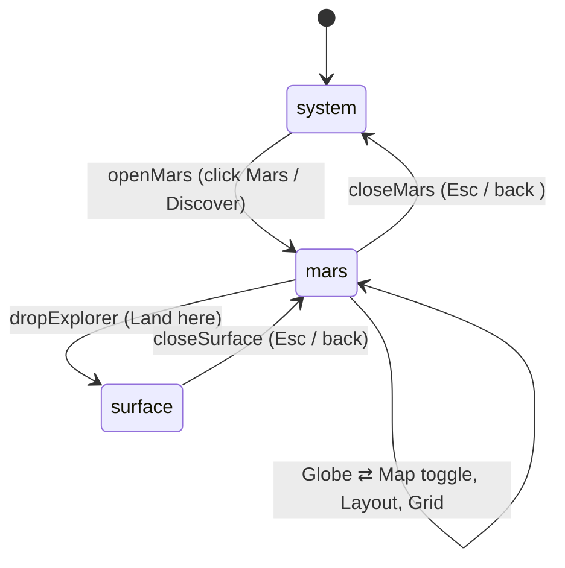
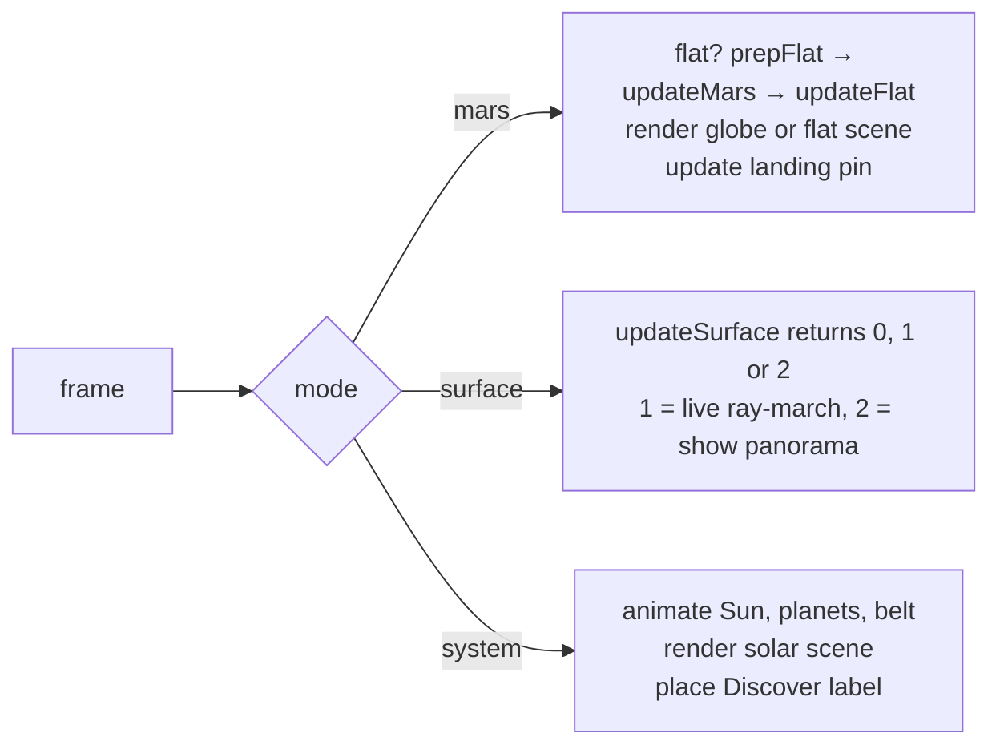

# Architecture

This document explains how **Mars Explorer** is built: its modes, modules, data pipeline, shaders and the conventions that hold it together. It is written for developers who want to understand, fix or extend the project.

## Table of Contents

1. [Overview](#overview)
2. [Tech Stack](#tech-stack)
3. [Modes and Navigation](#modes-and-navigation)
4. [Module Map](#module-map)
5. [Wiring and Shared State](#wiring-and-shared-state)
6. [The Frame Loop](#the-frame-loop)
7. [Solar System View](#solar-system-view)
8. [Mars Globe](#mars-globe)
9. [Flat Map](#flat-map)
10. [Data and Tiles](#data-and-tiles)
11. [Shaders](#shaders)
12. [Surface View](#surface-view)
13. [Sun and Time Model](#sun-and-time-model)
14. [Coordinates and Conventions](#coordinates-and-conventions)
15. [User Interface Layer](#user-interface-layer)
16. [Performance](#performance)
17. [Known Issues and Technical Debt](#known-issues-and-technical-debt)

---

## Overview

Mars Explorer is a single-page WebGL application with four views:

| Mode | What the user sees |
|------|--------------------|
| `system` | Animated Solar System (Sun, 8 planets, asteroid belt, stars) with a "Discover" label above Mars |
| `mars` | Detailed globe of Mars with real relief, data layers, grid, moons and Sun-lit terminator |
| `mars` + flat | The same Mars drawn as a flat equirectangular map (toggle **Globe / Map**) |
| `surface` | First-person view from a chosen point, with terrain, Mars sky, Sun and stars |

## Tech Stack

| Area | Technology |
|------|-----------|
| 3D engine | three.js **0.128.0** |
| Build tool | Vite 5 |
| Language | JavaScript ES modules |
| Shaders | GLSL (WebGL) |
| UI | HTML/CSS |
| Data | 2 local height-map PNGs and remote NASA Mars Trek tiles |

## Modes and Navigation



The current mode is the single value `state.mode` in `main.js`. Every module reads it through a `getMode()` function, and handlers check it before reacting. A second flag, `state.transitioning`, blocks input while a transition is running.

All transitions use the full-screen **veil** (`#veil`): fade to the loading screen, build or switch scene content, then fade out. `openMars`, `closeMars`, `dropExplorer` and `closeSurface` follow the same pattern with short `wait()` delays so the CSS fade can finish.

## Module Map

| Folder | Responsibility |
|--------|----------------|
| `core/` | `createRenderer` (WebGL renderer, scene, camera, WebGL-failure fallback) and `createViewportController` (resize logic, camera fit) |
| `solar/` | Solar System scene and the screen-space "Discover" label |
| `mars/` | Everything about the detailed globe (see [Mars Globe](#mars-globe)) |
| `flat/` | Flat map view built on top of the globe's material |
| `surface/` | First-person renderer, panorama builder, HUD, mode controller |
| `markers/` | The left "Markers" panel shell and its "Places of interest" section |
| `data/` | Tile URLs and loading, mosaics, height decoding, color ramps, Mars solar model |
| `lib/` | Pure helpers: noise, angles, formatting, view clamps, `wait`/`waitFor` |
| `shaders/` | GLSL sources and `index.js` that concatenates them into programs |
| `app/` | Device detection and all DOM pointer, wheel and keyboard input |

## Wiring and Shared State

`main.js` creates every module once and connects them. It does not contain the logic itself.

- **Dependency injection with getters.** Modules receive functions such as `getMarsMat: () => marsMat` instead of the objects. This is necessary because the Mars scene is built **lazily** (on first open), and because several modules depend on each other in cycles (`home` ⇄ `peg`, `landing` ⇄ `surfaceController`). Getters let `main.js` create them in any order.
- **`state`** holds `mode`, `transitioning`, `renderDirty` and `uiTimer`.
- **`mv`** is the globe camera state shared by input, controls, transitions and the per-frame update:

| Field | Meaning |
|-------|---------|
| `spin`, `pitch`, `dist` | Current globe rotation and camera distance (in Mars radii) |
| `tSpin`, `tPitch`, `tDist` | Targets the values are smoothed toward |
| `fit` | Distance at which the whole planet fits the screen (recomputed on resize) |
| `fly`, `auto`, `dragging`, `userZoomed` | Behavior flags: animated fly-to, idle auto-rotation, active drag, user has zoomed manually |
| `vSpin`, `vPitch` | Release velocity for drag inertia |

- **`ui`** is a bundle of `document.getElementById` references to the HTML elements.
- **Dirty flag.** `markDirty()` sets `state.renderDirty`. The globe renders every frame; the surface view uses the flag to avoid redrawing an unchanged image.

## The Frame Loop

`frame()` in `main.js` runs on `requestAnimationFrame`, clamps `dt` to 50 ms, and branches on the mode:



`updateMars(dt, ctx)` (in `mars/update.js`) does the per-frame work for the globe:

1. smooth distance, handle fly-to animation, drag inertia and idle rotation;
2. apply `spin` to the planet and `pitch` to its parent, and place the camera at `(0, 0, dist)`;
3. update the real Sun direction, the "thermally lagged" Sun direction and the solar flux for Mars's current orbital distance;
4. move the moons and the Sun light;
5. request texture levels and select the mesh level of detail;
6. update labels;
7. every 0.5 s, refresh the text readout and detail tiles;
8. adapt the pixel ratio if frames are slow.

## Solar System View

`solar/system.js` builds, in one function, the lights, Sun, planets, orbit lines, asteroid belt and star field.

- **Sun:** a sphere with a procedural fragment shader (domain-warped simplex noise) plus two additive glow sprites.
- **Planets:** eight spheres with canvas-generated procedural textures (`solar/textures.js`), glow halos, Saturn's rings and Earth's clouds. Sizes and distances are stylized, and speeds are made up rather than taken from ephemerides.
- **Asteroid belt:** 3 variants × 220 instanced rocks between the orbits of Mars and Jupiter, animated each frame on the CPU (`updateBelts`).
- **Stars:** 1,900 twinkling points on a distant sphere (custom shader with per-star phase, speed and color).
- **Discover label:** `solar/planet-tag.js` projects Mars to screen space each frame, positions the HTML label above it and fades it out when Mars is behind the Sun.

## Mars Globe

The globe lives in its own scene, built by `mars/scene.js` on first use.

**Scene graph**

```
marsScene
├── marsRoot            ← rotation.x = pitch
│   ├── marsSpin        ← rotation.y = spin
│   │   └── Mars sphere mesh (one of three LOD meshes, shared marsMat)
│   ├── atmosphere shell (radius 1.1, back-side, additive)
│   └── moon pivots → Phobos, Deimos (procedural rock shapes)
├── ambient light + directional light (placed along the real Sun direction)
└── star Points
```

The camera never orbits. It stays at `(0, 0, dist)` and the planet rotates in front of it.

**Three independent level-of-detail systems**

| System | File | Levels | Chosen by |
|--------|------|--------|-----------|
| Mesh | `mars/geo.js` | sphere with 160×80, 480×240, 1024×512 segments (the largest is currently disabled by `MAX_GEO = 1`) | camera distance, with hysteresis |
| Global textures | `mars/textures.js` | 1024×512, 2048×1024, 4096×2048 (touch devices stop one level lower) | camera distance (>4.3, >2.9, closer) |
| Detail window | `mars/tiles.js` | 1024×1024 px window (+64 px padding) of a deeper tile level, centered on the view | zoom 4–7 by distance; active only below about 2.9 radii |

Detail windows are cached (5 on desktop, 2 on touch) and their GPU textures are disposed when evicted. A window is replaced when the view centre moves more than 300 px from its centre. Window origins snap to multiples of 256 px.

**Display modes** (Layout menu, `controls.setViewMode`):

| `data-mode` | Layer | Shader `uMode` |
|-------------|-------|----------------|
| 0 | Natural color | 0 |
| 1 | Elevation (MOLA) | 1 |
| 2 | Temperature (modelled, live) | 2 |
| 3–7 | Roughness, Dust, Plagioclase, Glass/Clay, Thermal inertia (Mars Trek overlays) | 3 |

`mars/elev.js` builds the overlay and elevation mosaics, keeps the sphere black with a "Loading…" label until a layer arrives, and falls back to the normal view if the tiles fail. `mars/legend.js` generates the legend gradient from the same ramps the shader uses.

**Interaction features**

- `mars/pick.js` converts a screen point to longitude/latitude by intersecting a ray with the unit sphere, and reads elevation from the height PNG.
- `mars/labels.js` positions HTML labels over the 3D scene (grid labels fade as they turn away; moon labels hide behind the planet).
- `mars/home.js` lets the user mark a 1° × 1° "home" sector (about 60 km), stored in `localStorage` under `marsHome2`, and shows its average elevation and modelled temperature.
- `mars/peg.js` and `mars/landing.js` implement the **Explorer**: drag or click to drop a pin, show a small rendered preview of the landing site, and start surface mode with **Land here**. Home mode and Explorer mode are mutually exclusive.
- `mars/controls.js` owns fly-to, zoom (including hold-to-zoom), the 30° grid, the sector caption, the status readout and the choice of detail zoom level.

## Flat Map

`flat/view.js` reuses the globe's fragment shader (`MARS_FRAG` with `FLAT` defined) and the same uniforms, so textures, layers and the grid work in both views.

- Geometry: a 4×2 plane repeated three times side by side so longitude wraps seamlessly. `x = lon / 90`, `y = lat / 90`.
- `mars-flat.vert` derives the direction vector from UV instead of the sphere position.
- The camera moves over the plane; its zoom comes from the same `mv.dist` used by the globe.
- Latitude panning is clamped so the view cannot go past the poles; pan, fly-to and picking have flat-map versions of the globe logic.
- With `FLAT` defined the shader lights the map evenly, with no night side and no terrain shadows.

## Data and Tiles

**Tile pyramid** (`data/tiles.js`). Tiles follow a WMTS-like equirectangular scheme: at zoom `z` the map has `2^(z+1)` columns and `2^z` rows of 256 px tiles; row 0 is the north, column 0 is at −180°. URLs are built from templates with `{z}`, `{row}`, `{col}`, `{Style}` and `{TileMatrixSet}` placeholders.

| Layer | Source | Max zoom |
|-------|--------|----------|
| Color | Mars Trek, Viking MDIM 2.1 color mosaic (232 m/px) | 8 |
| Elevation color | Mars Trek, MOLA ClrShade | 7 |
| Overlays | Mars Trek: roughness, TES dust, plagioclase, glass/clay, thermal inertia | 1 |

**Loading** (`loadTileImg`): images are fetched with `crossOrigin = 'anonymous'`, cached in memory (160 entries), and a missing or failed tile resolves to `null` instead of throwing, so the app degrades to placeholder colors.

**Mosaics** (`data/mosaic.js`): `buildMosaic(kind, z, x0, y0, w, h)` stitches tiles into one canvas, wrapping longitude around the globe. If the requested zoom is deeper than a layer provides, it takes the deepest available level and stretches it.

**Height data.** The terrain is stored in two local PNGs:

| File | Size | Role |
|------|------|------|
| `assets/mars-height.png` | 2048 × 1024 | Globe and flat map relief, elevation lookups (`pick.siteHeightKm`) |
| `assets/mars-height-surface.png` | 1024 × 512 | Relief for the first-person view |

Both pack elevation into two 8-bit channels: `km = (R × 256 + G) / 65535 × 31 − 9`. In shaders this is `dec16()`. Textures are sampled with nearest filtering and interpolated manually in the shader (bilinear, and Catmull-Rom bicubic in the surface view).

**Color ramps** (`data/colorRamps.js`) define the elevation (−8.2 to 21.2 km) and temperature (140 to 315 K) palettes. The same tables drive the legend and the shader ramp textures.

## Shaders

GLSL files in `shaders/` are imported with `?raw` and assembled in `shaders/index.js`:

| Export | Built from | Used by |
|--------|-----------|---------|
| `MARS_VERT` | `noise.glsl` + `mars-common.glsl` + `mars.vert` | Globe mesh: displaces vertices by the real height (`r = 1 + h / 3389.5`) |
| `MARS_FRAG` | `mars.frag` only | Globe and flat map |
| `MARS_FLAT_VERT` | `mars-flat.vert` | Flat map |
| `MARS_ATMO_VERT/FRAG` | `mars-atmo.*` | Atmosphere shell: warm lit limb, blue near the terminator |
| `SURF_VERT` | `surface.vert` | Full-screen quad for the surface views |
| `SURF_FRAG` | `#define H_SMOOTH`, `#define PREC` + common + `surface-body.glsl` | Surface ray-marcher |
| `SURF_SHOW_FRAG` | `surface-show.frag` | Displays a finished panorama |
| `NOISE_GLSL` | `noise.glsl` | Sun shader and shared noise |

**`mars-common.glsl`** contains the height-map functions: `dec16`, bilinear and optional bicubic sampling, blending with the detail window, and `hKmS`, a high-precision lookup that stores the observer position as integer plus fraction so precision is not lost at large texture coordinates.

**`mars.frag`** computes, per pixel:

1. the surface normal from height differences (the step grows with pixel size to avoid sparkling at a distance), plus tiny procedural bump detail only when zoomed in very close;
2. albedo by `uMode` (color map, elevation ramp, temperature model or overlay);
3. terminator lighting from the sphere, and terrain shadows by marching toward the Sun through the height map (enabled by `SHADOW_STEPS`, desktop only);
4. a thin atmosphere haze, tone mapping and gamma;
5. the latitude/longitude grid, the highlighted sector and the pink home sector.

Important defines: `SHADOW_STEPS` (6 on desktop, 0 on touch), `CRATER_LAYERS`, `FLAT`, `H_SMOOTH`, `PREC`, `PANO`, `STEPS`.

## Surface View

The first-person view has **no 3D mesh**. A full-screen quad (orthographic camera, 2×2 plane) is drawn with a fragment shader that ray-marches the height field for every pixel.

**Geometry model.** Positions are in a local tangent frame in kilometres: `x` east, `y` north, `z` up, centered on the observer. The ground height is the height map minus planetary curvature (`|q|² / 2R`). The eye is 1.7 m above the ground.

**Ray marching** (`surface-body.glsl`): the step size grows with distance, a 6-step bisection refines the hit, normals come from finite differences over a wide step (smooth), and shadows are traced toward the Sun. Rays that reach the horizon without a hit are treated as terrain, so no flat haze plane appears.

**Appearance.**
- Relief comes from the 1024 × 512 height map (about 21 km per texel at the equator), smoothed with bicubic filtering. Fine detail is added to **color only**: patches from kilometers down to meters, gravel down to 1 cm and sand ripples.
- The sky has a butterscotch day sky, a blue glow around the Sun, blue sunsets, a Sun disc and, at night, a star field with a Milky Way band.
- Distance haze, ACES-style tone mapping and dithering finish the image.

**Three materials, one shader** (`surface/scene.js`):

| Material | Purpose |
|----------|---------|
| live (`surfMat`) | Renders directly to the screen when zoomed in |
| panorama (`panoMat`) | Same shader with `PANO` defined, more steps, renders 360° × 180° into a texture |
| show (`showMat`) | Samples the finished panorama for the current view (cheap) |

**Panorama strategy** (`surface/pano.js`, `surface/controller.js`). Rendering the full ray-march every frame is expensive, so:

- the panorama (4096 × 2048 on desktop, 2048 × 1024 on touch devices) is rendered in 32 horizontal strips over many frames, into one of two render targets (double buffering);
- while the field of view is 38° or wider (`PANO_MIN_FOV`), the user just looks around a finished panorama;
- when zoomed in further, the live ray-marcher runs at a lower pixel ratio while moving, and restores it after 0.25 s of stillness;
- the panorama is rebuilt every 25 s (the Sun moves) or when the base texture level changes.

`updateSurface()` returns `0` (nothing to draw), `1` (draw live) or `2` (draw panorama) to the frame loop.

**Mode flow.** `dropExplorer(lon, lat)` shows the veil, builds the surface scene, sets the location and noise seeds, loads texture level 1 and the surface height map, compiles the three shader programs, starts the first panorama and waits for it (up to 25 s). The starting view looks toward the Sun if it is low (under about 26°) and away from it otherwise. `closeSurface()` flies the globe back to the landing point.

**HUD** (`surface/hud.js`): local solar time, Sun altitude, azimuth and Ls, a phase name (Morning, Sunrise, Dawn, Pre-dawn twilight, Night and so on), sunrise and sunset times, polar day and night, and an SVG compass rose.

## Sun and Time Model

`data/marsSolar.js` implements the Allison & McEwen **Mars24** algorithm: from the current UTC time it computes the solar longitude `Ls`, the equation of time, the subsolar longitude and latitude and the Mars Coordinated Time.

- `mars/sun.js` calls it every frame and exposes `info` (`lonE`, `lat`, `Ls`, `mtc`) and `dir` (a unit vector in globe coordinates).
- `sunFor(lon, lat, offset)` returns the Sun direction in a point's local east/north/up axes and a rotation matrix for the star field.
- The globe also uses a **lagged** Sun direction (+18° of longitude) for the temperature model, and the solar flux scales with Mars's distance from the Sun (eccentricity 0.0934).

Local true solar time at a longitude is `12 + (lon − subsolarLon) / 15` hours.

## Coordinates and Conventions

| Item | Convention |
|------|------------|
| Longitude | East-positive, −180°…180° internally |
| Latitude | Planetocentric |
| Radius | 3389.5 km (`R_KM`); camera distance is in Mars radii (1.06 to 9) |
| Globe point | `(cos lat · cos lon, sin lat, −cos lat · sin lon)` |
| Inverse | `lon = atan2(−z, x)`, `lat = asin(y)` |
| UV on the sphere | `u = lon / 360 + 0.5`, `v = lat / 180 + 0.5` |
| Tile rows | Row 0 is the northernmost row; column 0 is at −180° |
| Flat map | `x = lon / 90`, `y = lat / 90` (world units) |
| Surface frame | `x` east, `y` north, `z` up; yaw measured clockwise from north |
| Elevation | km relative to the Mars datum; range −9 to +22 km in the height PNGs |

Keep these conversions in the existing helpers (`lib/view.js`, `mars/pick.js`, `data/marsSolar.js`) rather than re-deriving them in new code.

## User Interface Layer

The whole interface is defined in `index.html` and styled by CSS files in `styles/`.

| Element | Purpose |
|---------|---------|
| `#stage` | Holds the WebGL canvas |
| `#mars-tag` | "Discover" label over Mars |
| `#mars-ui` | Mars HUD: back button, status lines, place chips, legend, tools, zoom, Markers panel, labels |
| `#surf-ui` | Surface HUD: back button, status, compass rose, time card, zoom |
| `#land-pin` | Landing pin with preview canvas and the **Land here** / **Cancel** buttons |
| `#peg-ghost` | The figure that follows the pointer while dragging the Explorer |
| `#veil` | Full-screen loading overlay with a random fact |
| `#fallback` | Message when WebGL is not available |

Modules attach behavior to these elements by `id`; the markup is the contract, so renaming an `id` means updating the matching `getElementById` call. `app/input.js` registers all pointer, wheel and keyboard handlers once; each handler returns early unless the current mode matches.

The **Markers** panel (`markers/panel.js`) is a shell with accordion sections. Each section is its own module (`markers/places.js`) with its own CSS file (`styles/markers/places.css`).

## Performance

- **Quality tiers** from `HEAVY` (non-touch devices): texture size, shadow steps, tile cache size, panorama resolution and ray-march steps.
- **Adaptive resolution** on both the globe (pixel ratio drops by 0.25 down to 0.75 when the average frame exceeds 34 ms) and the surface view.
- **Lazy loading:** the Mars scene, textures and surface scene are created on first use, and higher texture levels load in the background after the globe opens.
- **Caching:** tile images (160), detail windows (5 or 2), the panorama (double buffer).
- **Panorama rendering is spread over frames**, so the interface stays responsive.
- **Shader compilation is forced** (`renderer.compile`) behind the loading veil to avoid hitches on first display.

See also: [Getting Started](getting_started.md),[Data sources](data-sources.md)
